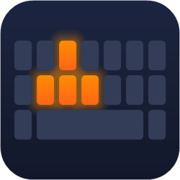
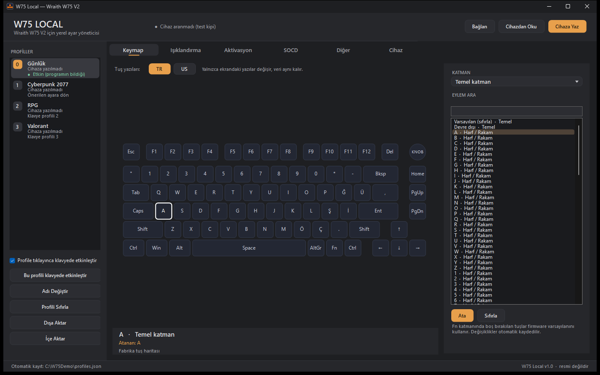
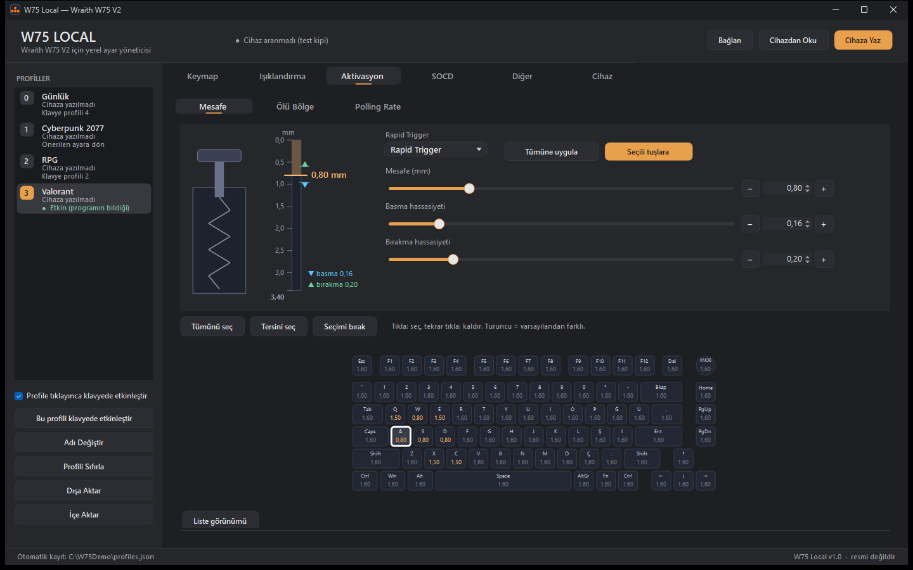
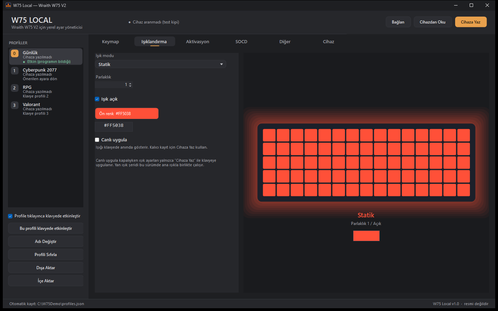
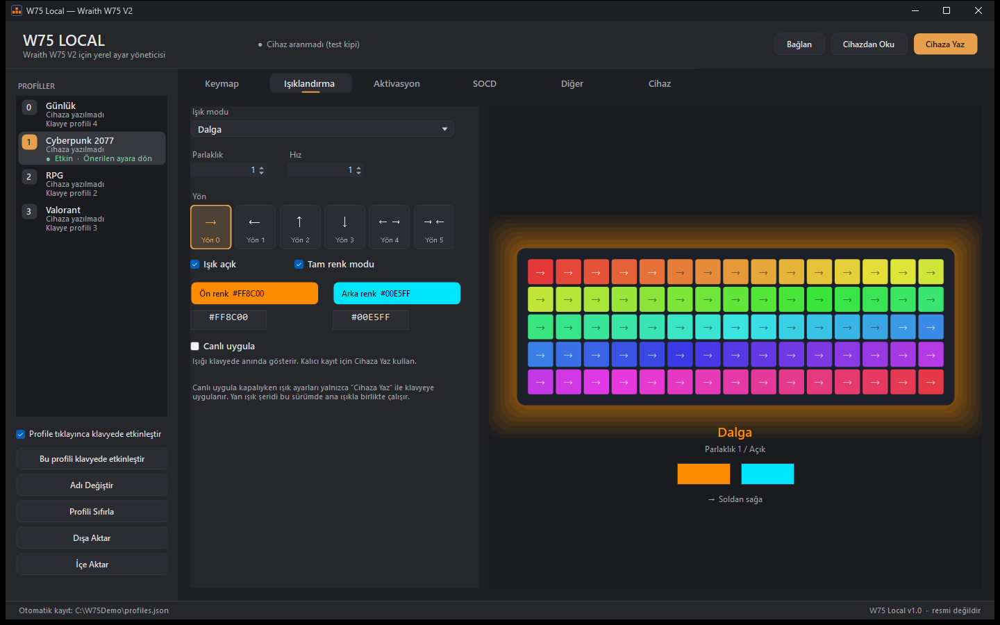
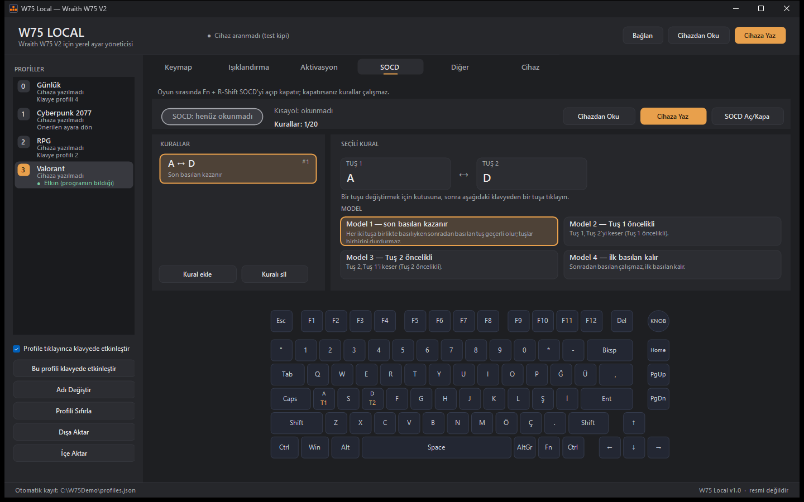
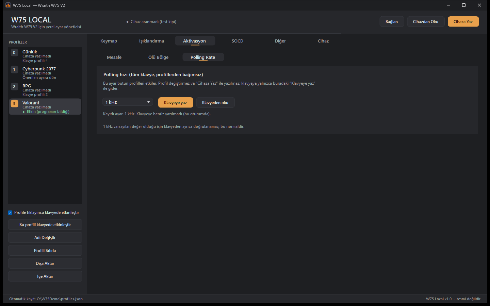
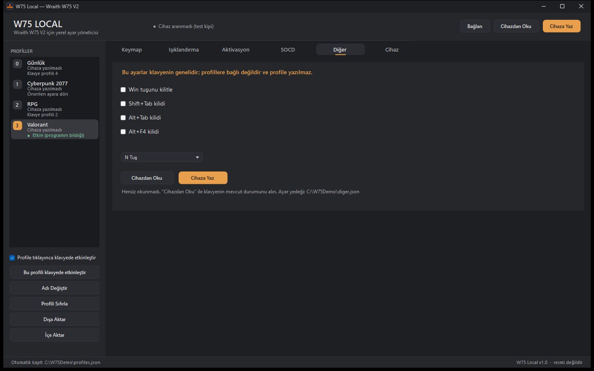
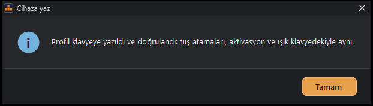

<p align="center">
  
</p>

# W75 Local

**Wraith W75 V2 için internet bağlantısı gerektirmeyen yerel ayar yöneticisi.**

Bağımsız, resmî olmayan bir programdır. Tarayıcıya (WebHID) gerek duymadan Windows üzerinde profilleri, tuş atamalarını, aktivasyon (Rapid Trigger) ayarlarını, ışıklandırmayı, SOCD kurallarını ve diğer klavye ayarlarını düzenler ve klavyeye yazar.

🇬🇧 **English summary:** [README.en.md](README.en.md) (the interface is Turkish only for now).

> **Sorumluluk reddi (kısa):** Bu proje bağımsız bir topluluk projesidir; Wraith veya klavyenin üreticisiyle bağlantısı, onayı ya da ortaklığı yoktur. Program klavyenin ayarlarına yazar: **kullanım tamamen kendi sorumluluğunuzdadır**, yazılım **"olduğu gibi"** sunulur, hiçbir garanti verilmez. Ayrıntı: [Sorumluluk reddi](#sorumluluk-reddi) ve [DISCLAIMER.md](DISCLAIMER.md).

## İçindekiler

[Neden?](#neden) · [Özellikler](#özellikler) · [Ekran görüntüleri](#ekran-görüntüleri) · [Kurulum](#kurulum-ve-indirme) · [Hızlı başlangıç](#hızlı-başlangıç) · [Sıkça sorulanlar](#sıkça-sorulanlar) · [Sorun giderme](#sorun-giderme) · [Bilinen sınırlar](#bilinen-sınırlar) · [Derleme](#geliştirme-ve-derleme) · [Katkı](#katkı) · [Sorumluluk reddi](#sorumluluk-reddi) · [Lisans](#lisans)

## Neden?

Klavyenin web tabanlı yapılandırma aracında ayarlar tarayıcıda durur; tarayıcı verisi silinirse kaybolabilir ve aracın çalışması için tarayıcı gerekir. Bu program ayarlarınızı **kendi bilgisayarınızda dosya olarak** (`%APPDATA%\W75Ayarlayici`) tutar:

- Tarayıcı önbelleği silinse bile profilleriniz kaybolmaz.
- Profilleri, yedekleri ve ayar paketlerini dışa/içe aktarabilir, başka bir bilgisayara taşıyabilirsiniz.
- Program **ağ erişimi kodu içermez**: güncelleme denetimi, telemetri ya da internete bağlanan hiçbir bölümü yoktur (kaynak kod taraması ve derlenmiş dosyanın taramasıyla doğrulandı; bkz. [SECURITY.md](SECURITY.md)).

## Özellikler

- **4 profil:** Günlük, Cyberpunk 2077, RPG, Valorant. Klavye 4 profil saklar; Günlük klavyenin 4. profilidir (diğerleri 1, 2, 3).
- **Tuş atamaları (Keymap):** Temel ve Fn katmanı, klavye çizimi üzerinden tuş seçme, TR/US tuş yazısı gösterimi.
- **Aktivasyon:** Tuş başına ya da çoklu seçimle tetikleme mesafesi, **Rapid Trigger** (basma/bırakma hassasiyeti), üst/alt ölü bölge; grafikli düzenleme ve liste görünümü.
- **Işıklandırma:** Statik, Nefes, Dalga, Neon, Radar, Reaktif, Aurora, Reaktif Dalgalanma, Pırıltı, Özel, Çapraz, Hıza Duyarlı, Oto Dalgalanma, Çizgilenme ve Havai Fişekler modları; parlaklık, hız, renkler (`#RRGGBB`), yön (ok kartlarıyla), canlı önizleme ve isteğe bağlı **Canlı uygula**.
- **Polling hızı:** 1 / 2 / 4 / 8 kHz. Klavyede profile özel değil, cihaz geneli bir ayardır; programda da tüm klavye için tek ayardır.
- **SOCD:** Karşılıklı yön tuşları için kural okuma, düzenleme, yazma ve açma/kapama.
- **Diğer:** Win, Shift+Tab, Alt+Tab ve Alt+F4 kilitleri; N tuş / 6 tuş modu.
- **Yazma sonrası doğrulama:** "Cihaza Yaz" sonrasında tuş atamaları, aktivasyon ve ışık klavyeden geri okunup kontrol edilir; sonuç tek bir kutuda gösterilir. Uyuşmazlıkta program kendiliğinden yeniden yazmaz.
- **Yedekleme ve taşıma:** Cihaz yedeği, profil dışa/içe aktarma, "Profili Sıfırla" (önce otomatik yedek), tüm ayarları tek pakette (zip) dışa/içe aktarma.
- **Koyu tema:** Pencere ve iletişim kutularının hepsi koyu temalıdır.
- **Güvenlik önlemleri:** Yazma işlemleri onay ister, yedek alınır, bozuk dosyalarda mevcut ayarlara dokunulmaz; program kendiliğinden bağlanıp yazmaz.

## Ekran görüntüleri

Görüntüler klavye bağlı olmadan (test kipinde) ve örnek profillerle alınmıştır.

| | |
|---|---|
|  |  |
| Tuş atamaları (Keymap) | Aktivasyon / Rapid Trigger |
|  |  |
| Işıklandırma (Statik) | Işıklandırma (Dalga ve yön) |
|  |  |
| SOCD kuralları | Polling hızı (tüm klavye) |
|  |  |
| Diğer ayarlar | Yazma sonrası doğrulama kutusu |

## Kurulum ve indirme

1. GitHub'daki [**Releases**](https://github.com/BaysungurLabs/W75-Local/releases) sayfasından en son sürümün `W75Local-v1.0.0.zip` dosyasını indirin.
2. Zip'i bir klasöre çıkarın (kurulum gerekmez; `W75Local.exe` doğrudan çalışır).
3. (Önerilir) İndirdiğiniz dosyayı doğrulayın: aşağıdaki [SHA256 doğrulama](#indirdiğim-dosyayı-nasıl-doğrularım) bölümüne bakın.

### Gereksinimler

- **Windows 10 veya 11** (64 bit). Program Windows 11'de test edilmiştir; Windows 10'da denenmemiştir.
- **.NET Framework 4.x:** Windows 10 ve 11'de varsayılan olarak yüklü gelir, ayrıca bir şey kurmanız gerekmez (bu bilgisayarda .NET Framework 4.8.1 ile doğrulandı).
- **Wraith W75 V2** klavye (`W75HEARGB`, USB VID `2E3C`, PID `C368`) USB kablosuyla bağlı. **Yalnızca firmware V3.22.07 ile test edilmiştir**; başka sürümler denenmemiştir.
- Yönetici izni gerekmez. Ek sürücü gerekmez.

## Hızlı başlangıç

1. Klavyenin web yapılandırma aracını ve klavyeyi kullanan diğer uygulamaları kapatın (aynı anda cihazı tutarlarsa program bağlanamaz).
2. Klavyeyi USB ile bağlayın ve `W75Local.exe` dosyasını çalıştırın. Sağ üstten **Bağlan**'a basın.
3. İlk kez kullanıyorsanız önce Cihaz sekmesinden **Yedek Al** yapın.
4. Soldan bir profil seçin (Günlük, Cyberpunk 2077, RPG, Valorant), ayarları düzenleyin. Değişiklikler bilgisayardaki profile otomatik kaydedilir.
5. Klavyeye kalıcı yazmak için **Cihaza Yaz**'a basın ve onaylayın. **Yazma sırasında USB kablosunu çıkarmayın.** Klavye yazmadan birkaç saniye sonra USB'den düşüp geri gelebilir; bu normaldir, program bunu bekler.
6. Sonuç kutusu ayarların klavyede doğrulandığını söyler. Klavyenin ışığına bakmak da iyi bir kontroldür.
7. Her profil için ayrı **Cihaza Yaz** gerekir. **SOCD**, **Diğer** ve **Polling hızı** ayarlarının kendi "Cihaza Yaz / Klavyeye yaz" düğmeleri vardır (profile bağlı değildirler).

Ayrıntılı anlatım: [docs/KULLANIM.md](docs/KULLANIM.md).

## Sıkça sorulanlar

### Windows "bilgisayarınızı korudu" (SmartScreen) uyarısı gösteriyor, güvenli mi?

Program **kod imzalama sertifikasıyla imzalı değildir** (ücretli sertifika gerekir; bu bağımsız bir açık kaynak projedir). Windows, yeni ve imzasız dosyalara bu uyarıyı gösterir. Çalıştırmak için **Daha fazla bilgi** > **Yine de çalıştır** seçeneğini kullanın. Bu uyarı programın zararlı olduğu anlamına gelmez; yine de yalnızca bu deponun [**Releases**](https://github.com/BaysungurLabs/W75-Local/releases) sayfasından indirdiğiniz dosyayı kullanın ve SHA256 değerini doğrulayın. Kaynak kodun tamamı bu depodadır, kendiniz de derleyebilirsiniz ([Geliştirme ve derleme](#geliştirme-ve-derleme)).

### Antivirüsüm yanlış alarm veriyor

İmzasız, küçük ve donanımla (HID) konuşan programlar bazen antivirüs yazılımlarında yanlış pozitif sonuç verebilir. Bunun nedeni genellikle dosyanın imzasız ve yeni olmasıdır. Emin olmak için: (1) SHA256 değerini doğrulayın, (2) kaynak kodu inceleyin, (3) isterseniz exe'yi kendiniz derleyin. Alarm sürerse dosyayı antivirüs üreticisine "yanlış pozitif" olarak bildirebilirsiniz.

### İndirdiğim dosyayı nasıl doğrularım?

Releases sayfasında (ve zip'in yanında) `SHA256.txt` dosyası vardır. PowerShell'i açın (Başlat'a "PowerShell" yazın) ve indirdiğiniz dosyanın klasöründe şunu çalıştırın:

```powershell
Get-FileHash .\W75Local-v1.0.0.zip -Algorithm SHA256
```

Çıkan `Hash` değeri `SHA256.txt` içindeki ilgili satırla **birebir aynı** olmalıdır (büyük/küçük harf fark etmez). Zip'ten çıkardığınız exe için de aynısını yapabilirsiniz:

```powershell
Get-FileHash .\W75Local.exe -Algorithm SHA256
```

Değerler farklıysa dosyayı kullanmayın; yeniden indirin.

### Profil numaraları nasıl? (Günlük neden klavyenin 4. profili?)

Klavye 4 profil saklar ve cihazda numaraları 1-4'tür. Programda sıra Günlük, Cyberpunk 2077, RPG, Valorant şeklindedir; klavyedeki karşılıkları: **Günlük = 4. profil**, Cyberpunk 2077 = 1., RPG = 2., Valorant = 3. profildir. Profil listesinde her profilin altında "Klavye profili N" yazar. Profil adları yalnızca programda tutulur, klavyeye yazılmaz.

### 1 kHz polling ve "doğrulanamadı" notu

Polling hızı klavyede profile özel değildir; program da bunu tek bir genel ayar olarak tutar ve **Cihaza Yaz** polling yazmaz: Aktivasyon > Polling Rate bölümündeki **Klavyeye yaz** ile yazılır. 1 kHz klavyenin varsayılan değeri olduğu için klavyeden ayrıca doğrulanamaz; bu normaldir. 2, 4 ve 8 kHz için program geri okuma ile doğrular.

### Ayarlarım nerede saklanıyor?

`%APPDATA%\W75Ayarlayici` klasöründe: `profiles.json` (profiller), `genel.json` (polling), `socd.json`, `diger.json`, `pencere.json` (pencere konumu) ve `backups\` (yedekler). Klasörü Cihaz sekmesindeki **Klasörü Aç** ile açabilirsiniz. Veri klasörünün adı geçmişe uyumluluk için `W75Ayarlayici` olarak kalmıştır.

### Program internete bağlanıyor mu?

Hayır. Kaynak kodda ağ erişimi yoktur (HTTP, soket, güncelleme denetimi, telemetri yok) ve derlenmiş exe'de ağ kütüphanesine başvuru bulunmaz. Program yalnızca USB (HID) üzerinden klavyeyle ve yerel dosyalarla çalışır.

### Valorant ya da başka oyunlarda kullanmak güvenli mi?

Bilmiyoruz ve bir garanti veremeyoruz. Program yalnızca klavyenin kendi ayarlarını değiştirir (oyuna ya da oyun belleğine müdahale etmez), ancak oyun yayıncılarının SOCD veya Rapid Trigger gibi donanım ayarlarına bakışı değişebilir ve bu araçla kullanımı hakkında doğrulanmış bir bilgi yoktur. Kuralları kontrol etmek ve sonucunu üstlenmek size aittir. Bkz. [Sorumluluk reddi](#sorumluluk-reddi).

## Sorun giderme

- **Cihaz bulunamadı:** USB kablosunu kontrol edin, klavyenin web yapılandırma aracını ve klavyeyi kullanan diğer programları kapatın, programı yeniden başlatıp **Bağlan**'a basın.
- **Yazdıktan sonra klavye bir an kayboldu:** Normaldir (yaklaşık 3 saniye). Program klavyenin geri gelmesini bekler. 5 saniye içinde gelmezse kabloyu çıkarıp takın ve **Cihazdan Oku** ile kontrol edin.
- **Kutu "klavye farklı gösteriyor" diyor:** Program kendiliğinden yeniden yazmaz. İsterseniz **Cihaza Yaz**'a yeniden basın; sürerse Cihaz sekmesindeki günlüğü kaydedip bir sorun bildirimi açın.
- **"Ayarlar kaydedilemedi":** Veri klasörü (`%APPDATA%\W75Ayarlayici`) salt okunur olabilir ya da başka bir program dosyayı kullanıyor olabilir.
- **"Program zaten açık":** Aynı ayar klasörünü kullanan ikinci bir kopya açılamaz; açık olan pencereyi kullanın.
- **Ayar bozuldu:** Cihaz sekmesinden **Yedekten Geri Yükle** ile son yedeği yükleyin ya da klavyenin web aracındaki fabrika ayarlarına dönün.
- **Bozuk bir ayar dosyası:** Program `profiles.json` bozuksa `.bozuk-*` uzantılı bir kopya alır ve varsayılan profillerle açılır.
- **Pencere/yazılar bulanık:** Program yüksek DPI farkındalığı bildirmez; Windows ölçekleme yaptığında yazılar biraz yumuşak görünebilir. En az 1080×600 piksellik etkin masaüstü alanı gerekir (örn. 1366×768 ekranda %125 ölçeğe kadar). Daha küçük etkin alanlarda (örn. 1080p ekranda %200) pencere sığmaz.

Sorun bildirmek için [**Issues**](https://github.com/BaysungurLabs/W75-Local/issues) sayfasındaki şablonu kullanın; kullanıcı adınız gibi kişisel bilgileri günlükten ve ekran görüntüsünden silin.

## Bilinen sınırlar

- Arayüz yalnızca **Türkçe**dir.
- Yalnızca **Wraith W75 V2** (`W75HEARGB`) ve **firmware V3.22.07** ile test edilmiştir; başka model/sürüm denenmemiştir.
- Yalnızca Windows ve USB kablolu bağlantı. Kablosuz modeller, GamePad kipi, makrolar, Switch seçimi, tuş kalibrasyonu ve yan ışık şeridi düzenleme **yoktur**; firmware güncellemesi yapılmaz.
- Tuş eylem listesinde yalnızca standart klavye tuşları vardır; medya, fare, kısayol ve kilit eylemleri yoktur (cihazın bu eylemler için kodlaması doğrulanamadığı için eklenmedi).
- Özel (tuş başına) ışık düzenleyicisi yoktur; ışık modları tek ön/arka renkle ayarlanır.
- Profil adları klavyeye yazılmaz; yalnızca programda tutulur.
- Klavye yazma komutlarına onay (ACK) cevabı vermediği için yazma doğrulaması **geri okuma** ile yapılır; polling ve profil seçimi geri okunamadığından yazma sonrası doğrulamaya girmez.
- Program imzasızdır (bkz. SSS).

## Geliştirme ve derleme

Gerekenler: **Windows** ve Windows ile gelen **.NET Framework 4 C# derleyicisi** (`csc.exe`, `C:\Windows\Microsoft.NET\Framework64\v4.0.30319\`). Başka bir araç ya da paket gerekmez.

```powershell
git clone https://github.com/BaysungurLabs/W75-Local.git
cd W75-Local
powershell -ExecutionPolicy Bypass -File derle.ps1
```

Çıktı `W75Local.exe` dosyasıdır (simge ve veri dosyaları exe'ye gömülür). Derleme uyarısız tamamlanır.

- `ikon\` simgeyi, `araclar\` simge ve veri dosyalarını (tuş düzeni, etiketler, eylemler) üreten betikleri içerir; yalnızca Windows'un `System.Drawing` kütüphanesini kullanır.
- Cihaza bağlanmadan denemek için `W75_CIHAZSIZ=1` (cihaza hiç bağlanmaz) ve `W75_VERI_KLASORU=<klasör>` (verileri başka bir klasörde tutar) ortam değişkenlerini kullanabilirsiniz. `W75_SIM_YAZ=1` (yalnızca `W75_CIHAZSIZ=1` ile) "Cihaza Yaz" ve etkinleştirme komutlarını klavyeye göndermeden simüle eder; `W75_SIM_DOGRULAMA=<senaryo>` yazma sonrası doğrulama kutularını (`ok`, `isik-farkli`, `fn-farkli`, `isik-okunamadi`, `geri-gelmedi`), `W75_SIM_POLL_OKU=<kHz>` polling kutularını, `W75_SIM_CIHAZ_YOK=1` "klavye takılı değil" durumunu, `W75_PAKET_DOSYA`, `W75_ICE_AKTAR_DOSYA` ve `W75_CIHAZ_YEDEK_DOSYA` dosya seçim pencerelerini atlayarak paket/içe aktarma/yedek akışlarını test eder. Bu değişkenler yalnızca test kipinde etkilidir.

## Katkı

Katkılar memnuniyetle karşılanır: hata bildirimi, öneri, belge düzeltmesi, kod. Önce [CONTRIBUTING.md](CONTRIBUTING.md) dosyasına bakın. Davranış kuralları: [CODE_OF_CONDUCT.md](CODE_OF_CONDUCT.md). Güvenlik açığı bildirimi: [SECURITY.md](SECURITY.md). Sürüm geçmişi: [CHANGELOG.md](CHANGELOG.md).

## Nasıl yapıldı

Bu program, yazılım bilgisi olmayan bir kullanıcı tarafından Claude Code gibi yapay zekâ destekli araçlarla geliştirilmiştir. Ayarlar gerçek bir Wraith W75 V2 klavyesinde (firmware V3.22.07) denenerek doğrulanmıştır.

## Sorumluluk reddi

- Bu proje **bağımsız, gayriresmî bir topluluk projesidir**. **Wraith** veya klavyenin üreticisi/satıcısıyla **hiçbir bağlantısı, onayı, sponsorluğu ya da ortaklığı yoktur**. "Wraith", "W75", "W75 V2" ve diğer ürün/marka adları ilgili sahiplerine aittir; bu belgelerde yalnızca uyumluluğu belirtmek için kullanılır.
- Program klavyenin **firmware ayarlarına yazar**. Doğru çalışacağı **garanti edilmez**; yalnızca Wraith W75 V2, firmware V3.22.07 ile test edilmiştir.
- **Kullanım tamamen kendi sorumluluğunuzdadır.** Yazılım **"OLDUĞU GİBİ"** sunulur; açık veya zımni **hiçbir garanti** (satılabilirlik, belirli bir amaca uygunluk, ihlal etmeme dahil) verilmez.
- Veri kaybı, ayar kaybı, cihaz arızası, garanti kaybı, oyun hesabı veya hizmet kısıtlaması dahil **hiçbir zarardan geliştirici sorumlu tutulamaz**.
- Yazma sırasında **USB kablosunu çıkarmayın**, yazmadan önce **yedek alın**. Program firmware güncellemesi yapmaz.
- Anti-hile (anti-cheat) sistemleri: Program yalnızca klavyenin kendi ayarlarını değiştirir, oyunlara müdahale etmez; ancak hiçbir oyunun veya hizmetin bu tür donanım ayarlarını kabul edeceği **garanti edilmez**. Kuralları kontrol etmek size aittir.

Tam metin: [DISCLAIMER.md](DISCLAIMER.md).

## Lisans

[MIT Lisansı](LICENSE) — Copyright (c) 2026 Baysungur.

Geliştirici: Baysungur. Benchmark ve mod tanıtım videoları çektiğim YouTube kanalı: [@BaysungurLabs](https://www.youtube.com/@BaysungurLabs)
